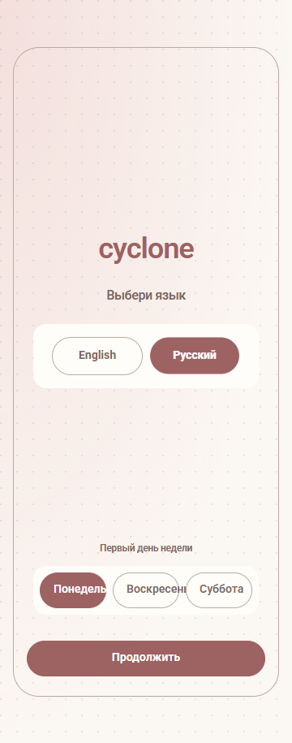
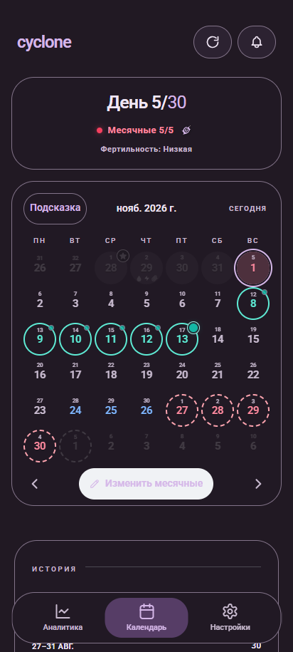
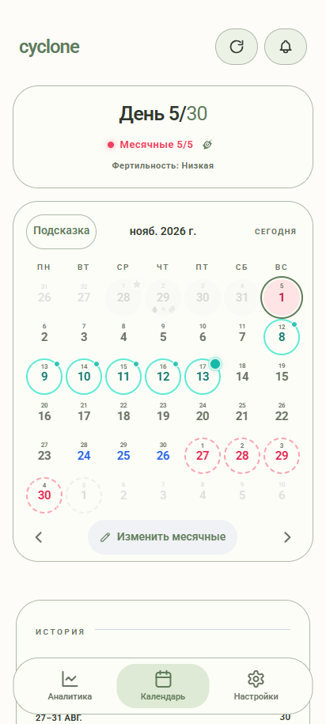
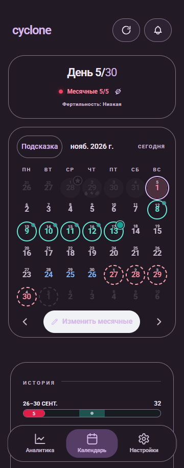
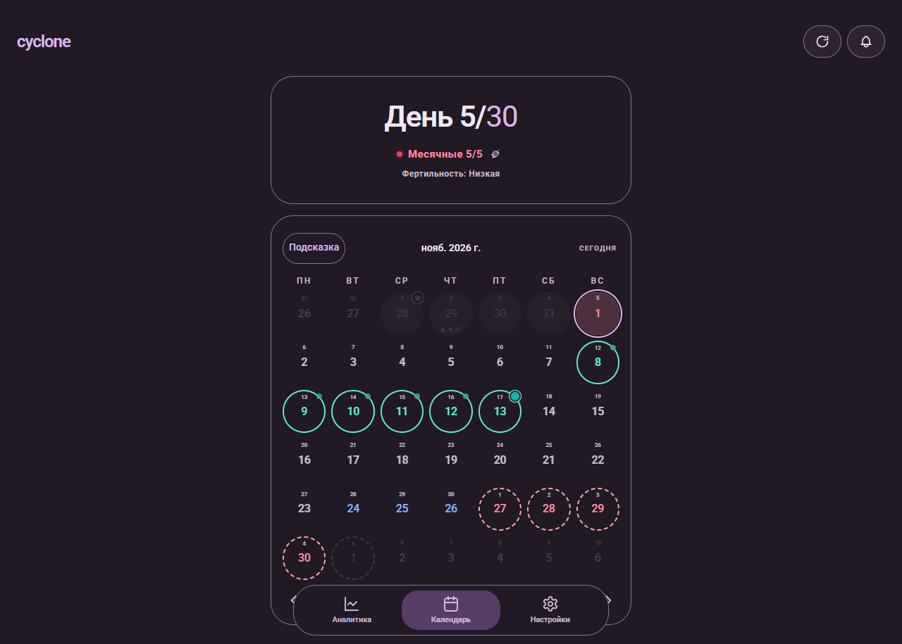
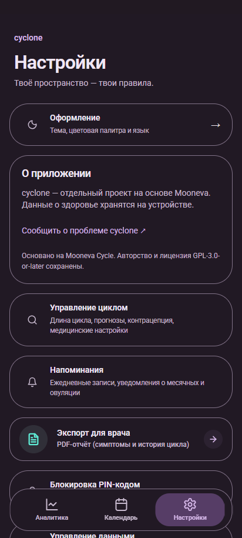
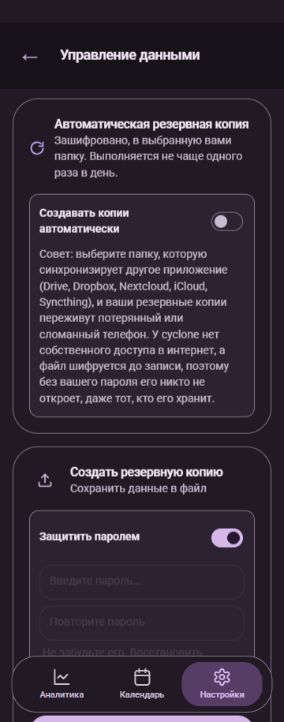
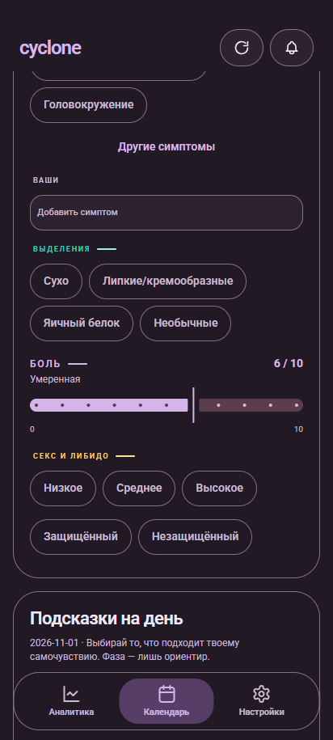
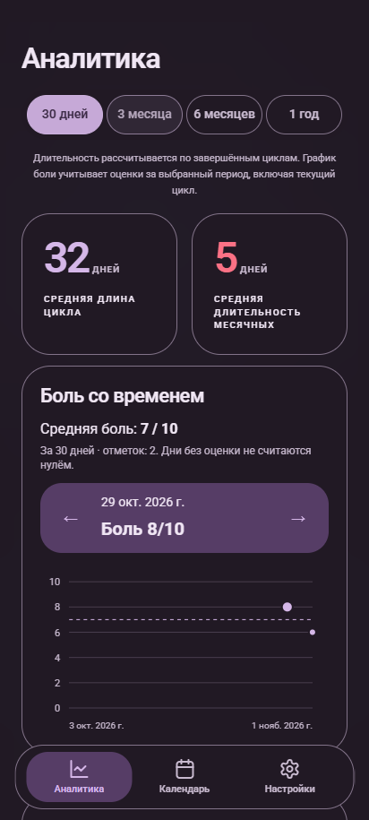

# cyclone-mooneva — обновление и проверка 1 ноября 2026

## Область работы

Проверялся отдельный React/Capacitor fork cyclone-mooneva. Соседний нативный ../cyclone не изменялся. README/FORK/ROADMAP, конфигурация и Git прочитаны; AGENTS.md в проекте и родительских каталогах не найден. Исходные изменения DEVLOG/CONTINUE_PROMPT сохранены.

Готовые branding/иконки из другого чата включены отдельным коммитом по прямому поручению пользователя. Canonical Vortex используется в web, Android launcher/adaptive/monochrome, splash, notification и внутри календаря. Исторические aliases сохранены, но используют новое artwork. Пользовательские файлы не сбрасывались.

## Сравнение upstream

Проверено fetch 2026-11-01. [Upstream main](https://github.com/aradar46/Mooneva-Cycle-Private-Period-Tracker/commit/827e36a2bd863efa24faae608ca826bb1d56eab1): **827e36a2bd863efa24faae608ca826bb1d56eab1**, дата коммита 2026-10-19T09:30:38Z, Release v3.0.0. Это же фактический `git merge-base HEAD upstream/main`. `git log HEAD..upstream/main` пуст: весь доступный upstream уже в истории форка. До работы fork имел 14 собственных коммитов поверх этой базы. Origin/main25f7766658cf4abfa8ecdbf51aa78f2e098e5930 включён отдельно без восстановления удалённых функций.

| Категория | Новые upstream изменения | Решение |
|---|---|---|
| Исправления ошибок | Нет коммитов после общей базы | Переносить нечего; исправлены найденные в нашем fork ошибки backup |
| Аналитика и прогноз | Исходный Mooneva3.0.0 уже включён | Сохранены; не менялись ради оформления, 6 contract tests проходят |
| Функции | Новых upstream commits нет | Сохранены боль/аналитика, подсказки, два виджета; Lab остаётся удалённой |
| Зависимости | Нет обновлений upstream для переноса | Добавлен Playwright1.58.2 только для QA; существующий lock сохранён |
| Хранение данных | Нового upstream schema нет | Ключи/schema не переименованы; усилена проверка повреждённых period objects |
| Интерфейс | Общая база уже присутствует | Сохранены пять палитр, auto/light/dark, en/ru, оформление cyclone |
| Конфликты | Нечего cherry-pick | Будущие Lab/hidden-mode UI не переносить автоматически |

GPL-3.0-or-later и авторство Mooneva сохранены. Roboto поставляется с OFL в public/fonts/Roboto-OFL.txt.

## Сделанные изменения

- `7ff7e60`: восстановлен ESLint flat config и lint gate CI. Исправления prefer-const не меняют математические операции.
- `95ac973`: браузерный export скачивает файл напрямую. Capacitor web Share shim ранее мог зависнуть на системном диалоге. Native Filesystem+Share сохранён; ошибки больше не скрываются native anchor fallback.
- Import отклоняет null, некорректную дату, отрицательную длину и неверные индексы period до записи данных. Старые backup без periods и с неизвестным optional Lab extension читаются. Корректный 40-дневный исторический record не обрезается: это проверка импорта, а не новый алгоритм прогноза.
- `eaedeea`: единые токены, компоненты и типографика; убраны встроенные светлые тени и !important из cyclone.css. Улучшены контраст light secondary, PIN disabled state; удалена недостижимая дублирующая ветка onboarding.
- `f2c8288`: готовые Vortex assets, единый generated React mark, web/Android/store integration. Проверено совпадение path в21Android vectors,11обычных aliases и10web PNG sizes. Виджеты не содержат отдельного старого логотипа; picker использует application icon.
- Календарные ячейки и оригинальная шкала Material3 сохраняют собственную геометрию. Алгоритмы прогнозирования не менялись.

## Система оформления

| Файл | Ответственность |
|---|---|
| styles/tokens.css | Локальный Roboto с кириллицей; шкала4/8/12/16/20/24/32px; rem-типографика; line-height1.45/1.2; радиусы16/24/32;44px targets; motion160ms |
| styles/palettes.css | Пять палитр × light/dark, semantic surface/text/border/primary tokens |
| styles/controls.css | Button/Choice/Card/Field, Toggle44×44 с видимым track40×24, disabled/error/reduced-motion, NumberSettingRow |
| components/ui/Controls.tsx | Общие React primitives с native keyboard/form semantics; Field сохраняет file-input ref |
| tailwind.config.js | Семантические цвета и единый font-family |
| cyclone.css | Совместимость с оставшимися upstream utility classes, layout/selected tabs/nav/safe-area |
| index.css | Upstream base/print/clinical styles; новая система не добавляет global!important |

Часть старых utility classes и специализированных print rules остаётся. Основные формы, onboarding, карточки, PIN, backup и analytics используют общие правила; новые экраны должны использовать primitives. Есть focus/selected/disabled/error и reduced-motion. Nav и резерв под ним растут при200%font. Цветовые токены проверены: основной/вторичный/selected текст ≥4.5:1 во всех десяти вариантах.

## Результаты проверок

Все результаты ниже получены заново 2026-11-01. Старые beta отчёты не используются как PASS этой сборки.

| Проверка | До | После | Свидетельство |
|---|---|---|---|
| TypeScript | PASS | PASS | logs/final-typecheck.log, exit0 |
| ESLint | FAIL: нет flat config | PASS | baseline-lint.log/final-lint.log; явные legacy исключения no-explicit-any/no-unused-vars, это не полный типовой аудит |
| Unit/integration | PASS15 | PASS21,5files | final-tests.log:6cycle/3pain/3suggestions/5backup/4controls |
| Web production build | PASS | PASS | final-build.log |
| Capacitor sync Android | PASS | PASS | final-cap-sync.log |
| Android assembleDebug | PASS | PASS | final-android.log,1m4s после объединения branding |
| APK signature/package | — | PASS | apk-signature.log; V2 signature |
| Календарь360/412/1280 ×10themes | — | PASS | web-results.json; геометрия, font, contrast; screenshots |
| Настройки+аналитика412 ×10themes | — | PASS | web-audit.log;50 theme/view combinations суммарно |
| First run en/ru, goal selection | — | PASS | web-audit.log; onboarding-360.png |
| Production onboarding/back, note edit/reload, PIN setup/unlock | — | PASS | production-flows.log, flows-results.json; isolated synthetic context |
| Боль null/0/10 и сохранение | — | PASS | unit null≠0; browser pointer0/drag10/keyboard6/reload |
| Interactive pain means и диапазоны дат | — | PASS | 90d4.5/30d7, переход между точками; unit future/missing handling |
| JSON export/import и повреждённый JSON | — | PASS | UI download/file picker/confirm/reload;4logs+4periods restored |
| Старые backups, malformed periods | — | PASS | tests/backupCompatibility.test.ts |
| Encrypted backup и неверный пароль | — | PASS | WebCrypto roundtrip и rejection; это не физический Drive provider |
| Auto theme,200%font | — | PASS в браузере | settings-font-200.png; no horizontal overflow основных блоков |
| Внешний интернет отключён после загрузки | — | PASS | блокируются внешние HTTPS; локальные данные/навигация работают |
| Browser console/page errors | — | PASS:0 | web-results.json errors[], flows-results.json errors[] |
| Иконки: source/web/React/Android refs | — | PASS | icon-assets.log, icon-browser.log; canonical SVG/PNG/refs, production favicon/apple HTTP200; native rendering требует emulator |
| Native Android installation/launch/WebView | — | НЕ ПРОВЕРЕНО | emulator backend не загружается до adb |
| Android Back/keyboard/permissions/notifications/background | — | НЕ ПРОВЕРЕНО | Android runtime недоступен; web PIN не заменяет эту проверку |
| Два виджета: размещение/theme/refresh/даты | — | НЕ ПРОВЕРЕНО | код сохранён, launcher host runtime требуется |
| Logcat приложения | — | НЕ ПРОВЕРЕНО | Android не стартовал, process отсутствует |
| Android cold start offline | — | НЕ ПРОВЕРЕНО | требуется рабочий emulator/device |
| Android font scale/IME/safe-area | — | НЕ ПРОВЕРЕНО | browser200% и CSS safe-area не заменяют WebView |
| Drive provider, отмена native share, реальный alarm delivery | — | НЕ ПРОВЕРЕНО | account/device не использовались |

### Ограничение эмулятора

Свой AVD cyclone_design, API35, порт5574; другие устройства не трогались. Emulator37.2.12 launcher завершался STATUS_DLL_NOT_FOUND(-1073741515), после диагностики поиска DLL — access violation. Прямой qemu backend зависал до открытия adb, включая GPUoff/Vulkanoff. WHPX проверка успешна. Временные добавленные SDK DLL удалены, наш backend остановлен.

Логи: emulator-verbose.log, emulator-repaired.log; полные direct/gpuoff логи в локальном verification/update-2026-11-01. scripts/native-quality-audit.mjs подготовлен, но **не выполнялся на загруженном Android**, и может требовать адаптации системных диалогов/локаторов.

## Команды и логи

Из корня cyclone-mooneva; Node24.22.1 локально (CI22), pnpm11.25.0; JDK21/SDK36/Gradle8.14.3.

```powershell
pnpm install --frozen-lockfile
pnpm run typecheck
pnpm run lint
pnpm exec vitest run --maxWorkers=2
pnpm build
pnpm exec cap sync android
$env:JAVA_HOME=(Resolve-Path '../.toolchain/jdk21/jdk-21.0.9+10').Path
$env:ANDROID_HOME=(Resolve-Path '../.toolchain/android-sdk').Path
./android/gradlew.bat -p android assembleDebug --max-workers=1 --console=plain
./android/gradlew.bat -p android --stop
# Browser matrix: dev server in another terminal
pnpm exec vite --host 127.0.0.1 --port 5174 --strictPort
pnpm test:browser
# Production UI: no dev-module imports
pnpm exec vite preview --host 127.0.0.1 --port 5175 --strictPort
$env:QA_URL='http://127.0.0.1:5175'
node scripts/quality-flows.mjs
```

Фактически локальные команды запускались через node и соответствующие CLI из node_modules: те же исполняемые программы. Playwright использует установленный Chrome; contexts изолированы, данные искусственные. Audit не подключается к личному профилю.

Полные логи/все PNG: verification/update-2026-11-01/ (ignored). Выбранные результаты находятся рядом с этим отчётом в logs/ и screenshots/. APK не коммитится в source.

## APK

Локальный файл: `../releases/cyclone-mooneva-quality-2026-11-01/cyclone-mooneva-quality.apk` (**6,225,253 bytes**).

SHA-256: `5c5ce0bc67ed748bf4de0e0bc0334edf62a85a2c74a99a217fd7eec6a21e3281`.

Package com.cyclone.mooneva.debug, version3.0.0-beta.4, code29, min24, target36; debug signed. Версия намеренно не повышена: это QA artifact, не опубликованный новый релиз. Application source commit **6c9aaf6** включает готовые иконки. Последующие изменения QA scripts/docs не меняют приложение. Android runtime ещё не подтверждён; бинарная воспроизводимость между разными debug keystores и окружениями не заявляется.

## Снимки











## Что осталось

- Разблокировать Android emulator или подключить отдельное тестовое устройство, выполнить runtime checklist и logcat, проверить оба widget hosts.
- Повторить native regression после восстановления Android runtime; не публиковать QA artifact как полностью проверенный релиз.
- Native cyclone JSON migration/biometric integration остаются отдельными задачами; полная поддержка не добавлялась.
- В web build остаётся предупреждение крупных chunks, в частности html2pdf. Lazy PDF bundle требует отдельной проверки перед оптимизацией.
- 21 тест — регрессия затронутых функций, а не доказательство отсутствия всех ошибок или клинической точности прогнозов.
